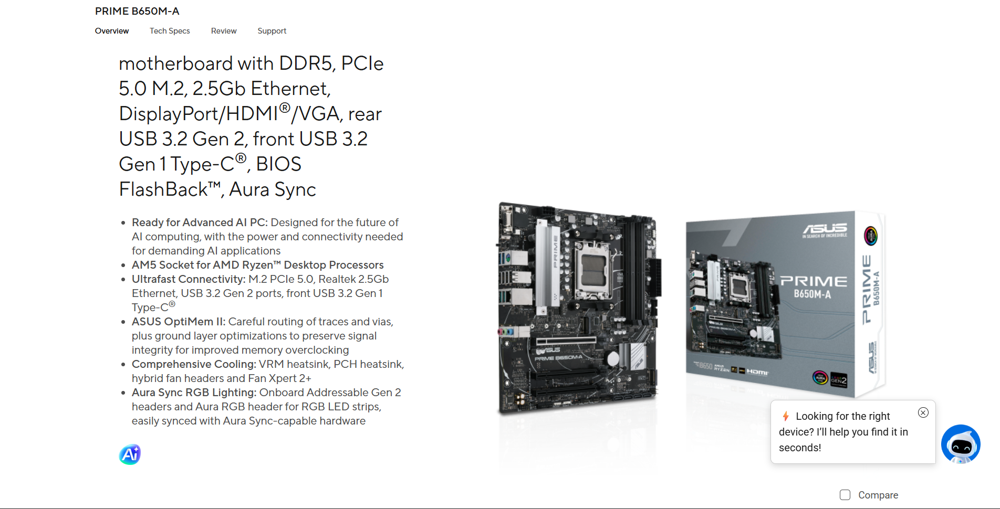
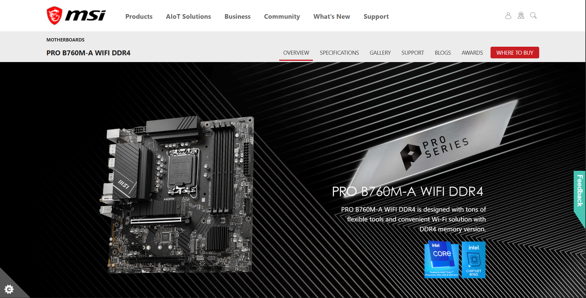
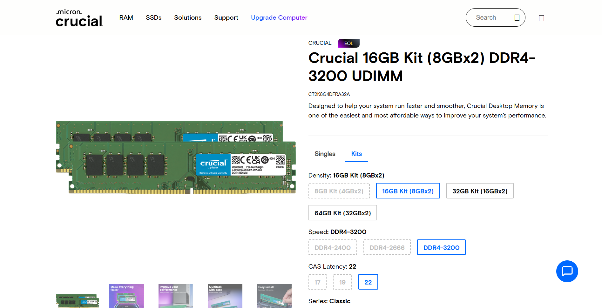
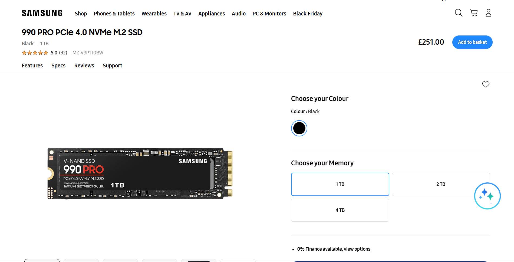
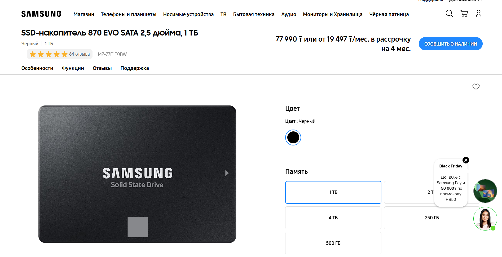

# Lab 3 — Teardown and the same machine from the command line

Pair: Amirgali A. + Aiganym K. · Date: 6 November 2026

## Part 1 — Ten parts

Product photos are saved under [`evidence/photos/`](evidence/photos/). Captions below summarize the exact models selected for the assignment. The specifications and compatibility details come from each manufacturer's product page.

### AMD Ryzen 5 7600

6 cores / 12 threads, AM5 desktop CPU, 65 W default TDP, DDR5 memory controller; its thermal solution is AMD Wraith Stealth. It fits an AM5 board such as the ASUS PRIME B650M-A and takes DDR5 UDIMMs. Limits: AM5 socket and DDR5 memory; the included cooler is a stock solution, not a separate high-performance cooler. [AMD product page](https://www.amd.com/en/products/processors/desktops/ryzen/7000-series/amd-ryzen-5-7600.html)

### Intel Core i5-13400

13th-generation desktop CPU with 10 cores (6 P-cores + 4 E-cores) and 16 threads, LGA1700, 65 W processor base power, DDR4 or DDR5 depending on motherboard. It fits the MSI PRO B760M-A WIFI DDR4 and connects to DDR4 UDIMMs in that board. Limits: LGA1700; this DDR4 motherboard cannot take DDR5. Intel lists Laminar RM1 in the box with the boxed i5-13400; a tray/OEM processor may not include a cooler. [Intel specifications](https://www.intel.com/content/www/us/en/products/sku/230495/intel-core-i513400-processor-20m-cache-up-to-4-60-ghz.html) 

### ASUS PRIME B650M-A

Micro-ATX motherboard with AMD B650 chipset and AM5 socket. It connects to Ryzen 7000/8000/9000 CPUs, has four DDR5 DIMM slots, two M.2 sockets and four SATA 6 Gb/s ports. Limits: AM5 CPUs and DDR5 only; the Ryzen 5 7600 belongs to the supported Ryzen 7000 family. Check ASUS's CPU support list and installed BIOS version before using a later CPU generation. [ASUS specifications](https://www.asus.com/motherboards-components/motherboards/prime/prime-b650m-a/techspec/) · [ASUS CPU support](https://www.asus.com/motherboards-components/motherboards/prime/prime-b650m-a/helpdesk_cpu/)

### MSI PRO B760M-A WIFI DDR4

Micro-ATX motherboard with Intel B760 chipset and LGA1700 socket. It supports Intel 12th/13th/14th-generation CPUs, has four DDR4 slots (up to 128 GB), two M.2 sockets and four SATA ports. The i5-13400 is a 13th-generation LGA1700 match. Limits: DDR4 only; a DDR5 module cannot fit. [MSI specifications](https://www.msi.com/Motherboard/PRO-B760M-A-WIFI-DDR4/Specification) 
### Kingston FURY Beast DDR5-5600, 16 GB

16 GB DDR5-5600 (5600 MT/s) desktop UDIMM, 288-pin. It connects to DDR5 DIMM slots, including the ASUS PRIME B650M-A. Limits: DDR5 boards only; it is physically and electrically incompatible with the MSI DDR4 board. The module's 5600 MT/s profile may require enabling the matching memory profile and depends on CPU/board configuration. [Kingston module datasheet](https://www.kingston.com/datasheets/KF556C40BB-16.pdf)

### Crucial DDR4-3200, 16 GB DIMM

16 GB DDR4-3200 desktop DIMM. It connects to DDR4 slots such as those on the MSI PRO B760M-A WIFI DDR4. Limits: DDR4 boards only; it cannot be installed in the ASUS DDR5 board. [Crucial DDR4 memory information](https://www.crucial.com/support/articles-faq-memory/differences-in-memory-speed-and-data-rate)

### Samsung 990 PRO, 1 TB

1 TB M.2 2280 NVMe SSD using PCIe 4.0 x4. It connects directly to an M.2 M-key slot; either board provides compatible M.2 PCIe storage. Limits: needs an M.2 NVMe/PCIe slot and is faster than SATA; the exact maximum speed depends on the slot generation and configuration. [Samsung specifications](https://semiconductor.samsung.com/consumer-storage/internal-ssd/990-pro/)

### Samsung 870 EVO, 1 TB

1 TB 2.5-inch SATA SSD (SATA 6 Gb/s), up to 560/530 MB/s sequential read/write. It connects to a board SATA port with SATA data and PSU power cables. Limits: SATA bandwidth caps it around 550 MB/s; unlike the 990 PRO, it does not install in an M.2 slot. [Samsung specifications](https://www.samsung.com/us/memory-storage/sata-ssd/870-evo-sata-2-5-ssd-1tb-sku-mz-77e1t0b-am/)

### CORSAIR RM750e, 750 W

.png)

750 W ATX power supply, fully modular, 80 PLUS Gold efficiency for the listed revision. It supplies the motherboard through 24-pin ATX and CPU EPS 8-pin power cables, plus SATA power for drives and PCIe power for a graphics card. Limits: total system demand must stay within 750 W; the PSU also needs to fit the case and have the required connectors. [CORSAIR specifications](https://www.corsair.com/us/en/p/psu/cp-9020262-na/rme-series-rm750e-fully-modular-low-noise-atx-power-supply-cp-9020262-na)

### Stock CPU cooler

The assignment's parts list names a stock cooler without a separate model/photo. AMD identifies the Ryzen 5 7600's thermal solution as Wraith Stealth; Intel includes Laminar RM1 with the boxed i5-13400. Both coolers match their CPU socket, but availability depends on the processor's boxed/tray package. [AMD Wraith Stealth](https://www.amd.com/en/products/processors/desktops/ryzen/7000-series/amd-ryzen-5-7600.html) · [Intel boxed contents](https://www.intel.com/content/www/us/en/support/articles/000095154/processors.html)

## Two builds

### Build 1 — AMD

| Part | Model | Why it fits |
| --- | --- | --- |
| CPU | AMD Ryzen 5 7600 | AM5 socket matches the board; supports DDR5. |
| Motherboard | ASUS PRIME B650M-A | AM5/B650 board with DDR5 DIMM slots and M.2/SATA storage. |
| Memory | Kingston FURY Beast DDR5-5600, 16 GB | DDR5 UDIMM matches the ASUS slots. |
| SSD | Samsung 990 PRO, 1 TB | M.2 NVMe PCIe SSD fits the board's M.2 socket. |
| Cooler | AMD Wraith Stealth | AMD lists this as the Ryzen 5 7600 thermal solution. |
| PSU | CORSAIR RM750e, 750 W | Provides ATX/EPS power; 750 W is the selected supply. |

Still needs: case that supports micro-ATX, display, and peripherals; a discrete GPU only if the workload needs more graphics performance than the CPU's integrated Radeon graphics.

### Build 2 — Intel

| Part | Model | Why it fits |
| --- | --- | --- |
| CPU | Intel Core i5-13400 | 13th-gen LGA1700 CPU matches the board. |
| Motherboard | MSI PRO B760M-A WIFI DDR4 | LGA1700/B760 board; specifically uses DDR4. |
| Memory | Crucial DDR4-3200, 16 GB DIMM | DDR4 module matches the board's memory slots. |
| SSD | Samsung 870 EVO, 1 TB | 2.5-inch SATA drive connects to a SATA port and PSU cable. |
| Cooler | Intel Laminar RM1 | Included with the boxed i5-13400; verify package contents if buying tray. |

Still needs: a separate compatible PSU (the single RM750e is allocated to Build 1), case that supports micro-ATX, display and peripherals; discrete GPU only if needed. The parts list contains one PSU, so the second build is a compatible paper build but is not complete as an independently powered PC with the listed parts.

## Part 2 — Same facts, three operating systems

Raw command output: [`evidence/windows-specs.txt`](evidence/windows-specs.txt) and [`evidence/linux-specs.txt`](evidence/linux-specs.txt). 
| Fact | Windows (PowerShell) | Linux (Ubuntu VM) |
| --- | --- | --- | --- |
| CPU model | `Get-CimInstance Win32_Processor`: Intel Core i5-13420H | `lscpu`: Intel Core i5-13420H |
| Cores / threads | `Get-CimInstance Win32_Processor`: 8 cores / 12 logical processors | `lscpu`: 2 CPUs, 2 cores, 1 thread/core (2 vCPUs assigned) |
| Total memory | Not recorded by the saved commands | `free -h`: 3.3 GiB total |
| Memory modules and speed | `Get-CimInstance Win32_PhysicalMemory`: two 8 GiB entries, 3200 MT/s; SMBIOS types report DDR4 | `sudo dmidecode -t memory`: SMBIOS 2.5 detected, no module detail returned |
| Disk model and type | `Get-PhysicalDisk`: SAMSUNG MZAL4512HBLU-00BL2, SSD, NVMe, 512 GB | `lsblk`: `VBOX HARDDISK`, 25 GB, SATA virtual disk |
| Free space | `Get-Volume C`: 45.44 GB remaining of 475.75 GB | `df -h /`: 7.1 GB available on 11 GB root filesystem |
| Architecture | `$env:PROCESSOR_ARCHITECTURE`: AMD64 | `uname -m`: x86_64 |

Windows reports the host laptop's full 8 cores and two physical 8 GiB memory entries, while Ubuntu reports a virtual machine with only 2 vCPUs and 3.3 GiB RAM. The VM also exposes a generic 25 GB `VBOX HARDDISK` instead of the host's 512 GB Samsung NVMe, and its virtual disk appears as SATA. Both systems report the same Intel i5-13420H model and x86-64 architecture, showing that the hypervisor passes through some CPU identity while limiting or virtualizing other hardware.

## What did not work the first time

In Ubuntu, `sudo dmidecode -t memory` did not show RAM module information: it identified only SMBIOS 2.5 via sysfs, unlike Windows, which listed two 8 GiB modules at 3200 MT/s. This is a VM visibility limitation, so I did not infer a memory speed from the Linux output. `lsblk` also showed the VM's virtual `VBOX HARDDISK` as a 25 GB SATA disk rather than exposing the host NVMe model; that difference is recorded as a finding, not treated as the host's real disk type.

## Evidence

- [`evidence/windows-specs.txt`](evidence/windows-specs.txt) — PowerShell output for CPU, physical memory, disk, C: volume and architecture.
- [`evidence/linux-specs.txt`](evidence/linux-specs.txt) — Ubuntu output for CPU, memory, DMI, virtual disk, root filesystem and architecture.
- [`evidence/photos/`](evidence/photos/) — maker product photos for the listed components. The folder currently has nine image files; the cooler has no separate photo, and the assignment does not specify a separate cooler model.
