# Build Document: Two Test Guests in VirtualBox

This guide describes how to create one Ubuntu Server guest and one Windows 11 guest in Oracle VM VirtualBox, connect them to the same NAT Network, check guest-to-guest connectivity, and save a clean snapshot of each guest. The exact wizard labels can differ slightly between VirtualBox releases.

## Before you start

You need a host computer with hardware virtualization enabled, VirtualBox installed, an Ubuntu Server installation ISO, and a Windows 11 installation ISO. Keep the ISO files in a known location. Confirm that the host has enough free RAM and disk space for the two guests and the host OS to run together. Windows 11 installation and activation must comply with the license available to you; choosing “I don't have a product key” does not provide a license.

This build assigns 4 GB RAM and 2 virtual CPUs to each guest, with dynamically allocated disks capped at 25 GB for Ubuntu and 40 GB for Windows. If your host differs from the one used for this build, reconsider the allocation before proceeding.


## Part 1: Ubuntu Server guest

### Step 1: Create the Ubuntu virtual machine

Open VirtualBox and select **New**. Name the machine `lab01-ubuntu`, choose **Linux** and **Ubuntu (64-bit)**, and select the Ubuntu Server ISO when prompted. Assign **4096 MB** of memory and **2 CPUs**. Choose **Skip Unattended Installation** so that the OS installer can be followed manually, then continue to the virtual disk setup.

**Why:** The 4 GB and 2 CPU allocation is the configuration used for this lab. The unattended installer is skipped so the account and installation choices can be made explicitly and documented.

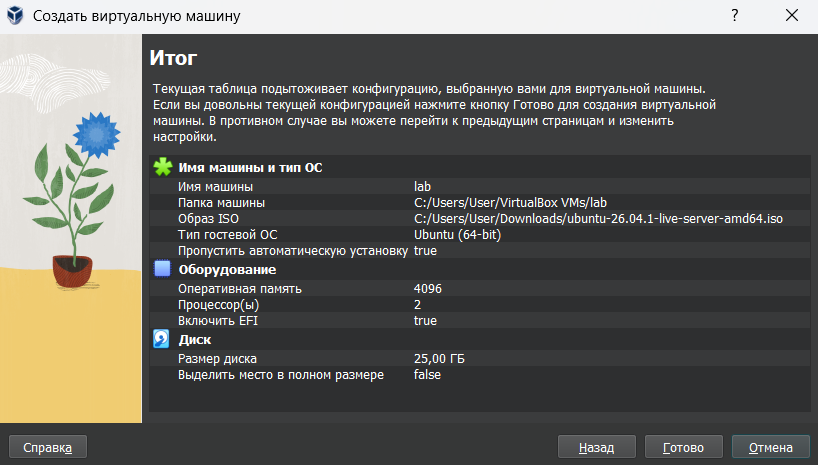

This is the available screenshot for the VM creation wizard. Check that the name, ISO, memory, and CPU settings are legible; supplement it with a current **System** settings screenshot if any of those values are not visible.

### Step 2: Create the Ubuntu virtual disk

Choose **Create a Virtual Hard Disk Now**. Select **VDI (VirtualBox Disk Image)**, choose **Dynamically allocated**, set the maximum size to **25 GB**, and finish creating the VM.

**Why:** A dynamically allocated disk file grows as the guest writes data, up to its 25 GB limit. It does not guarantee that a particular amount of host disk space will remain free.

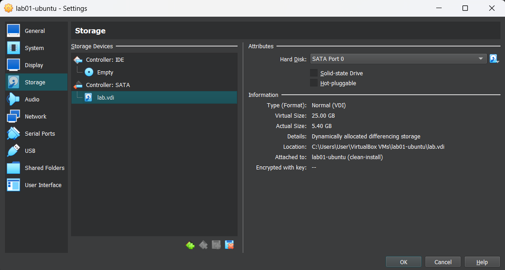

This is the available disk settings screenshot. It should visibly show the VDI format, dynamic allocation, and 25 GB maximum.

### Step 3: Create or select the shared NAT Network

In the VirtualBox Manager, open **Tools** and find **Network** or **Network Manager** (the name varies by version). Open the **NAT Networks** tab and create a network if one does not already exist. Name it `NatNetwork`, enable the network and its DHCP server, and note the subnet and gateway shown by VirtualBox. Do not assume a particular subnet unless the Network Manager confirms it. Save the network settings.

Select `lab01-ubuntu`, open **Settings → Network → Adapter 1**, enable the adapter, set **Attached to** to **NAT Network**, and select `NatNetwork`. Save the VM settings.

**Why:** Both guests need to attach to the same NAT Network to test communication with one another while using the host for outbound connectivity. A standard NAT adapter on each VM is not the same shared network.

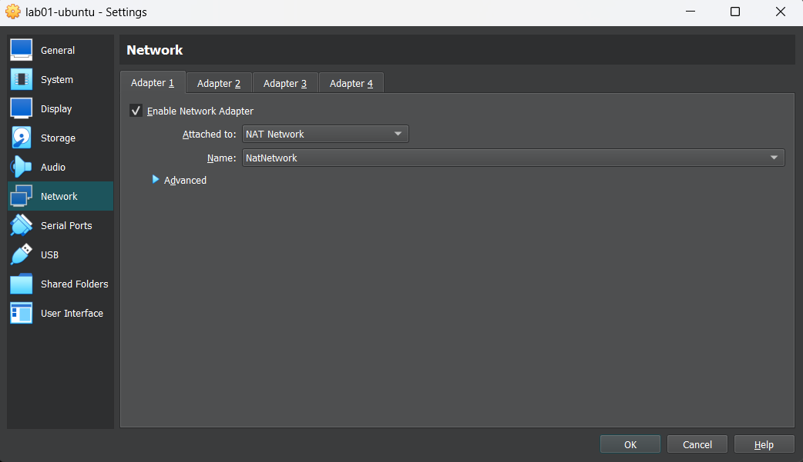

This is the available network adapter screenshot. It documents the adapter setting shown in the image. It does not by itself prove the NAT Network subnet, DHCP setting, or Windows VM's adapter; add screenshots of those settings if they are not visible elsewhere.

### Step 4: Install Ubuntu Server (or document the already-installed guest)

Select `lab01-ubuntu` and click **Start**. Follow the Ubuntu Server installer. Choose the language, keyboard layout, and network configuration appropriate for the lab. Use the default partitioning of the empty virtual disk unless the assignment requires another layout. Create a non-shared lab account; the original build used username `amirgali` and hostname `lab1`. Set a unique password locally and do not publish it in this document or commit it to GitHub. Finish installation and reboot when prompted.

After reboot, if the installer asks to remove the installation medium, eject the ISO using the VirtualBox **Devices → Optical Drives** menu, then press Enter. In the VM's **Settings → Storage**, confirm the installer ISO is no longer mounted so that the VM boots from its virtual disk.

**Why:** The VM has its own virtual disk, so the OS can be installed without changing the host. A unique local password avoids exposing credentials in a public build guide.

If Ubuntu is already installed and you no longer have the installer screens, do not repeat the installation just to obtain screenshots. Instead, capture the running VM and its current **Settings → System**, **Storage**, and **Network** pages, and use the verification evidence in Step 5. These screenshots document the present setup, but they cannot prove which choices were made in the earlier installer. In the report, say that the installation screens were not captured. If this is a build guide intended for another person, retain the written installation instructions so that person can perform a fresh installation.

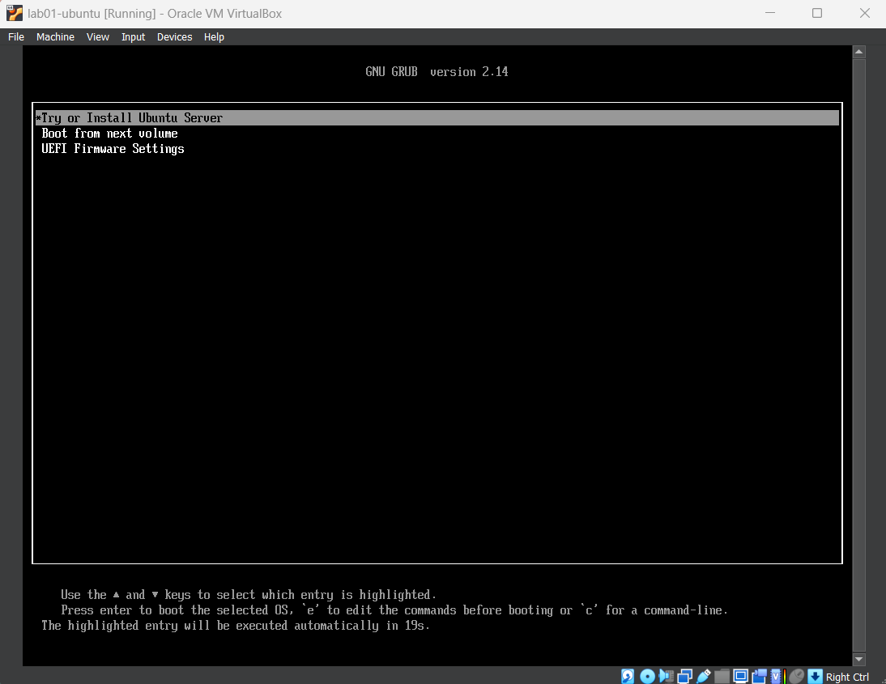

### Step 5: Verify the Ubuntu guest

Log in to Ubuntu and run:

```bash
uname -a
ip addr
ip route
```

Confirm that `uname -a` reports a Linux kernel and `x86_64`, and record the guest's actual IPv4 address and default route. The address can differ from `10.0.2.5` if the NAT Network has a different subnet or DHCP allocation. `evidence/04-guest-uname.txt` contains `uname -a`; `evidence/05b-guest-ipaddr.png` shows `ip addr` and `ip route`, including address `10.0.2.5` and default route `10.0.2.1`.

**Why:** These commands confirm the guest booted and show its real network configuration. Recording actual output makes later network checks reproducible.

The Linux kernel output is in `evidence/04-guest-uname.txt`. The address and route output is shown below:

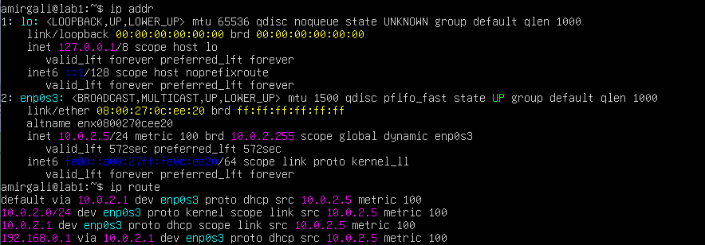

## Part 2: Windows 11 guest

### Step 6: Create the Windows virtual machine

In VirtualBox Manager, select **New**. Name the machine `lab02-windows`, choose **Microsoft Windows** and **Windows 11 (64-bit)**, and select the Windows 11 ISO. Assign **4096 MB** of memory and **2 CPUs**. Choose **Skip Unattended Installation** to follow the installer manually, then continue to disk setup.

**Why:** These are the resource settings used for this lab. Skipping unattended setup makes it possible to document the installation choices and account setup.

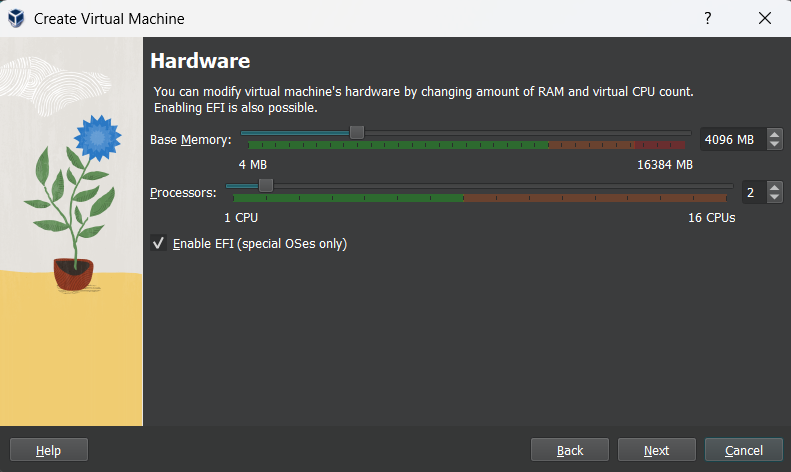

This shows 4096 MB of memory and 2 CPUs. The VM name and Windows ISO selection are not visible in this capture, so document those choices in text or add a screenshot showing them.

### Step 7: Create the Windows virtual disk

Choose **Create a Virtual Hard Disk Now**, select **VDI**, choose **Dynamically allocated**, and set the maximum size to **40 GB**. Finish creating the VM.

**Why:** The 40 GB virtual capacity is the limit selected for this lab. Dynamic allocation lets the host file grow with guest data, but the guest still cannot use more than the configured maximum.

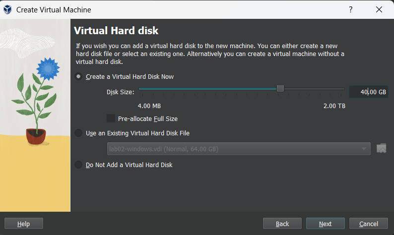

The screenshot shows a 40 GB disk and **Pre-allocate Full Size** unchecked, indicating dynamic allocation in this wizard.

### Step 8: Connect Windows to `NatNetwork`

Select `lab02-windows`, open **Settings → Network → Adapter 1**, enable the adapter, set **Attached to** to **NAT Network**, and select the same `NatNetwork` used by Ubuntu. Save the settings. Confirm both VMs are attached to that same named network.

**Why:** Using the same NAT Network allows the guests to communicate through the virtual network. The actual IP addresses depend on the subnet and DHCP server configured in Step 3.

The Ubuntu adapter screenshot is `evidence/03-network-adapter.png`. The Windows adapter screenshot below shows `lab02-windows` attached to `NatNetwork`:

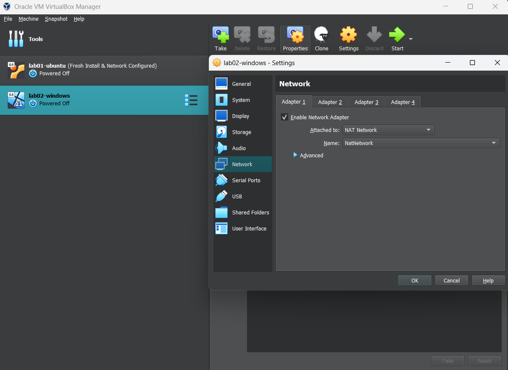

Both guests' adapters are shown attached to the same named network. These screenshots do not show the NAT Network subnet or DHCP configuration; add that evidence if available.

### Step 9: Install and verify Windows

Start `lab02-windows` and follow Windows Setup. Select the appropriate language and keyboard. When asked for a product key, enter a valid key if you have one; otherwise, you may choose **I don't have a product key** only if permitted for your intended installation. Select the Windows edition that matches the license available to you. Choose **Custom: Install Windows only** and install to the unallocated virtual disk. Complete the out-of-box setup and create a local account if that option is available in your installer version. Use a unique password and do not include it in this document.

After setup and reboot, eject the ISO from **Devices → Optical Drives** if prompted. In VM **Settings → Storage**, confirm the ISO is no longer mounted.

Open PowerShell and run:

```powershell
ipconfig
route print -4
```

Record the actual IPv4 address and default route. Do not assume the address is `10.0.2.4` unless the output confirms it.

**Why:** The selected edition and activation status must match the available license. Checking the real IP configuration avoids relying on example addresses that may not match the configured NAT Network.

The current Windows network evidence shows IPv4 address `10.0.2.4`, subnet mask, default gateway, and route table:

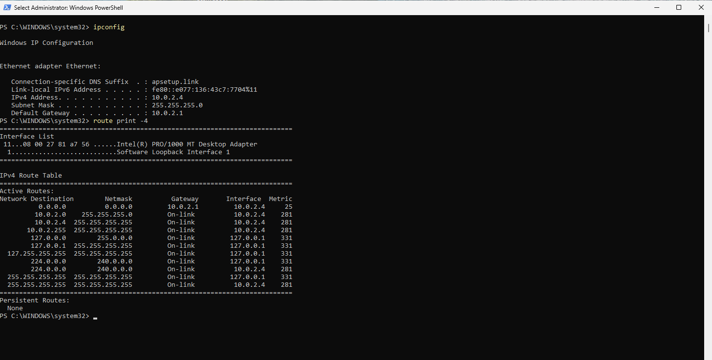

No Windows installer screenshots are present. Do not present this post-installation screenshot as evidence of the installation screens or selected edition.

## Part 3: Connectivity checks and snapshots

### Step 10: Allow the ping test through Windows Firewall

In the Windows guest, open **Windows Terminal (Admin)** or **PowerShell (Admin)**. Run this command to add an inbound rule for ICMPv4 echo requests:

```powershell
New-NetFirewallRule -DisplayName "Allow ping in (ICMPv4)" -Protocol ICMPv4 -IcmpType 8 -Direction Inbound -Action Allow
```

If the rule already exists, inspect it before creating a duplicate. Keep Windows Firewall enabled. To inspect the rule, run:

```powershell
Get-NetFirewallRule -DisplayName "Allow ping in (ICMPv4)"
```

**Why:** Windows Firewall may block incoming echo requests by default. This rule permits the specific diagnostic traffic needed for this lab without disabling the firewall. On a managed device, follow the administrator's network policy.

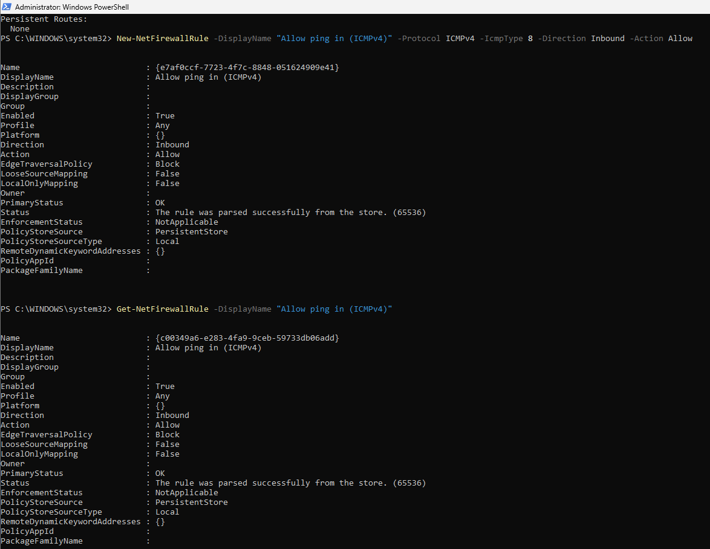

This shows the inbound ICMPv4 rule being created and inspected as enabled. The rule permits echo requests for the connectivity check while leaving Windows Firewall enabled.

### Step 11: Test guest-to-guest and internet connectivity

First, use the actual addresses recorded in Steps 5 and 9. From Ubuntu, replace `<WINDOWS_IP>` with the Windows guest's address and run:

```bash
ping -c 4 <WINDOWS_IP>
```

From Windows PowerShell, replace `<LINUX_IP>` with the Ubuntu guest's address and run:

```powershell
ping -n 4 <LINUX_IP>
```

Both guest-to-guest checks should receive all four replies. If they fail, verify that both adapters use the same `NatNetwork`, that both guests have addresses in the configured subnet, that the Windows rule is enabled, and that the host or network policy is not blocking traffic.

Then verify outbound internet access from each guest separately. From Ubuntu, run:

```bash
ping -c 4 1.1.1.1
getent hosts example.com
```

From Windows PowerShell, run:

```powershell
ping -n 4 1.1.1.1
Resolve-DnsName example.com
```

Record the actual outputs. A successful ping to an IP checks IP connectivity; successful name resolution checks DNS. Some networks block ICMP, so if the IP ping fails, use an approved HTTPS connectivity check and document the command and result instead of claiming that internet access is unavailable.

**Why:** Inter-guest ping verifies communication between the two guests. Separate IP and DNS checks distinguish general outbound connectivity from name resolution. The existing `evidence/05-ping-between-guests.txt` records successful guest-to-guest pings; it does not show the internet or DNS tests listed above.


### Step 12: Take a clean snapshot of each guest

Shut down both guests cleanly. In VirtualBox Manager, select `lab01-ubuntu`, open **Snapshots**, choose **Take**, and name the snapshot `Fresh Install & Network Configured`. Repeat for `lab02-windows`. Confirm the snapshot list shows a snapshot under each VM.

**Why:** Separate snapshots preserve a known clean state for each VM. A snapshot is a recovery point, not a substitute for a backup of important data.

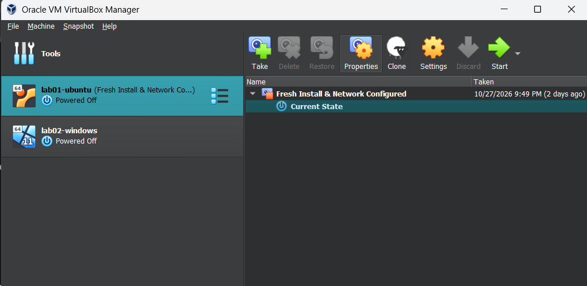

`evidence/06-snapshot-list.png` shows the Ubuntu VM and its `Fresh Install & Network Configured` snapshot. The additional screenshot below shows the Windows VM and a snapshot with the same name:

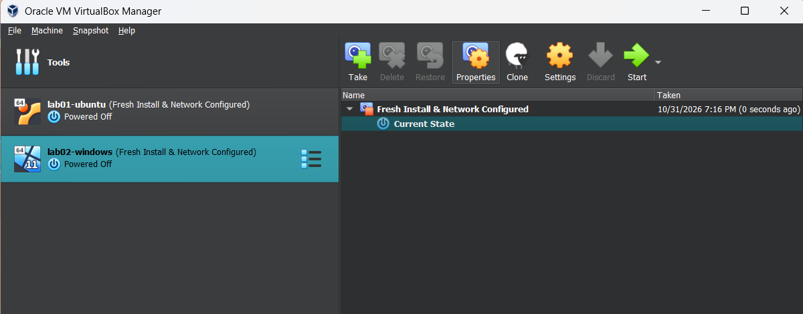

## Evidence checklist

The current evidence directory contains:

- `evidence/01-new-vm-wizard.png`
- `evidence/02-disk-settings.png`
- `evidence/03-network-adapter.png`
- `evidence/04-guest-uname.txt`
- `evidence/04b-ubuntu-install.png`
- `evidence/05-ping-between-guests.txt`
- `evidence/05b-guest-ipaddr.png`
- `evidence/06-snapshot-list.png`
- `evidence/06b-windows-vm-wizard.png`
- `evidence/07b-windows-disk-settings.png`
- `evidence/08b-windows-network-adapter.png`
- `evidence/09b-windows-ip.png`
- `evidence/10a-windows-firewall-rule.png`
- `evidence/11b-windows-snapshot.png`

