# Build document: Ubuntu and Windows 11 test guests in VirtualBox

This procedure creates two virtual machines on one host, connects them to a shared NAT Network, verifies internet and guest-to-guest connectivity, and takes a clean snapshot of each guest. It is written for Oracle VM VirtualBox 7.0.20; button names can vary slightly in other releases.

## Before you start

Download VirtualBox from [Oracle's VirtualBox downloads page](https://www.virtualbox.org/wiki/Downloads), Ubuntu Server from [ubuntu.com/download/server](https://ubuntu.com/download/server), and Windows 11 Enterprise Evaluation from [Microsoft Evaluation Center](https://www.microsoft.com/en-us/evalcenter/download-windows-11-enterprise). Use the ISO architecture that matches the host. This build uses x86-64 guests.

Confirm hardware virtualization is enabled in the host firmware. On the host, check available RAM and free disk space before creating the VMs. This build assigns 4 GB RAM to each guest and sets virtual disk maximums of 25 GB for Ubuntu and 64 GB for Windows; keep additional free space for the host OS, applications, updates, and snapshots. The 
40 GB Windows disk matches Microsoft's published minimum storage requirement. An evaluation ISO is for evaluation under Microsoft's terms; use an edition and licence approved by IT for a real employee workstation.

Do not use production credentials or connect test software to production services. A snapshot can return a guest to its saved state, but it does not protect the host, external systems, or files stored outside that guest.

## Part 1: Ubuntu Server

### Step 1 — Create the Ubuntu VM

Open VirtualBox Manager, select **New**, name the VM `lab01-ubuntu`, choose **Linux → Ubuntu (64-bit)**, and select the Ubuntu Server ISO. Assign **4096 MB** RAM and **2 CPUs**, then choose **Skip Unattended Installation**.

**Why:** A manually followed installer makes the account and OS choices visible and repeatable. The 4 GB/2 CPU allocation is the lab's starting point and leaves half of the host's 16 GB RAM unassigned when both VMs run.

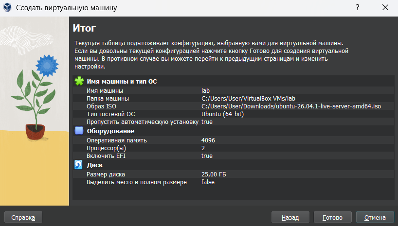

### Step 2 — Create the Ubuntu disk

Choose **Create a Virtual Hard Disk Now**, select **VDI**, choose **Dynamically allocated**, and set the maximum size to **25 GB**. Finish the VM wizard.

**Why:** The VDI grows as Ubuntu writes data, up to the configured limit, so the host does not reserve all 25 GB immediately. Dynamic allocation still requires monitoring host free space.

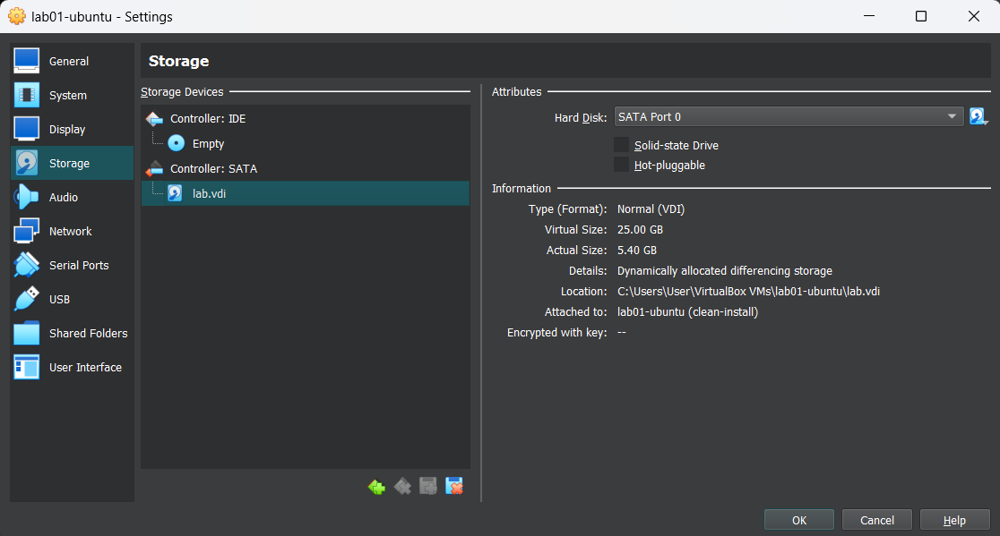

### Step 3 — Create the shared NAT Network and attach Ubuntu

In VirtualBox Manager, open **Tools → Network → NAT Networks**. Create or select an enabled network named `NatNetwork`, enable DHCP, and record the subnet and gateway shown in the manager. Save it. Select `lab01-ubuntu`, open **Settings → Network → Adapter 1**, enable the adapter, choose **NAT Network**, select `NatNetwork`, and save.

**Why:** A shared NAT Network gives the guest outbound access through the host and lets both guests communicate on the same virtual network. Separate default NAT adapters provide outbound access but do not create this shared guest network; bridged mode would expose guests directly to the physical LAN.

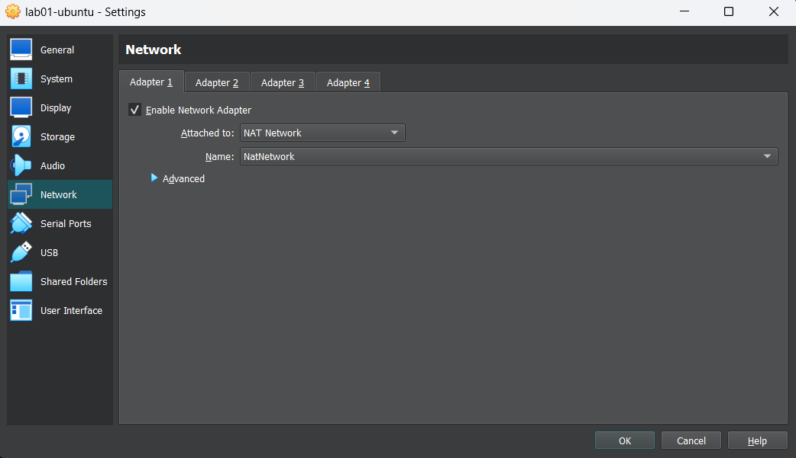

### Step 4 — Install Ubuntu Server

Start `lab01-ubuntu` and follow the Ubuntu Server installer. Choose the required language and keyboard, keep the default network configuration if DHCP succeeds, use the default guided partitioning on the empty virtual disk, and create a dedicated lab account. In this build the account is `amirgali` and the hostname is `lab1`; set a unique password locally and never include it in the repository. Complete installation and reboot. Eject the ISO from **Devices → Optical Drives** if prompted, then confirm it is no longer mounted under **Settings → Storage**.

**Why:** Ubuntu is installed to the VM's virtual disk, so the host operating system is untouched. A dedicated guest account keeps lab activity separate from host accounts.

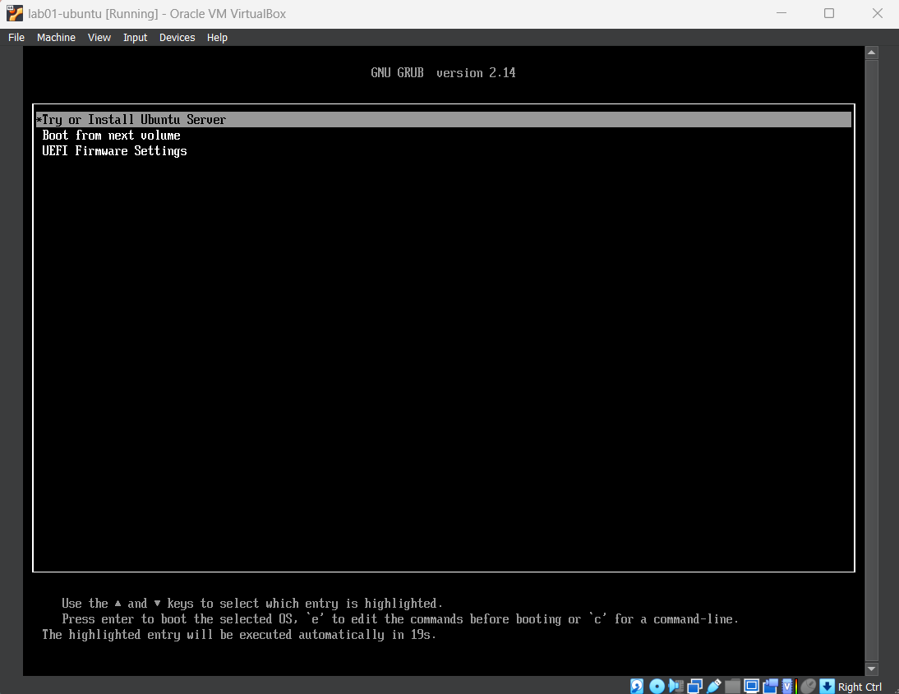

### Step 5 — Verify Ubuntu's OS and network

Log in and run:

```bash
uname -a
ip addr
ip route
```

Record the actual address and default route; do not substitute example values. The expected evidence in this build shows the Linux guest at `10.0.2.5/24` with a default route through `10.0.2.1`.

**Why:** These commands confirm that the guest booted and received a usable network configuration. Recording the actual address provides the target for the Windows-to-Linux connectivity check.

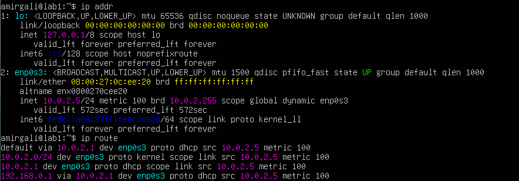

The `uname -a` output is in [`evidence/04-guest-uname.txt`](evidence/04-guest-uname.txt).

## Part 2: Windows 11 Enterprise Evaluation

### Step 6 — Create the Windows VM with UEFI

Select **New**, name the VM `lab02-windows`, choose **Microsoft Windows → Windows 11 (64-bit)**, and select the Windows 11 Enterprise Evaluation ISO. Assign **4096 MB** RAM and **2 CPUs**. In the hardware page, leave **Enable EFI** checked, then choose **Skip Unattended Installation**.

**Why:** The selected ISO supplies the Enterprise Evaluation edition. UEFI is required for a standard Windows 11 VM configuration; the screenshot records that EFI is enabled in the wizard.

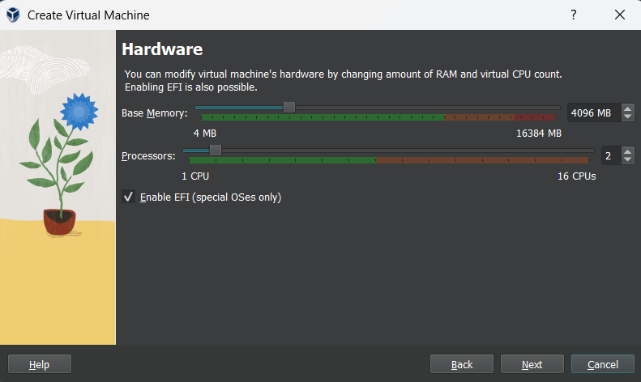

### Step 7 — Create the Windows disk

Choose **Create a Virtual Hard Disk Now**, select **VDI**, choose **Dynamically allocated**, and set the maximum size to **40 GB**. Finish creating the VM.

**Why:** Microsoft lists 40 GB as the minimum storage device size for Windows 11. Dynamic allocation avoids reserving the full maximum at once, while the guest can grow only up to the configured limit.

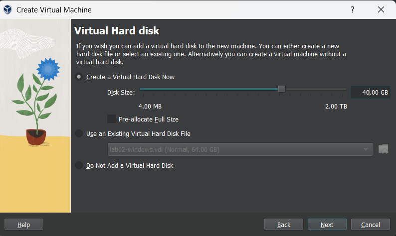

### Step 8 — Enable and verify Secure Boot and TPM 2.0

Keep `lab02-windows` powered off. Open **Settings → System → Motherboard**. Confirm **Enable EFI** is selected, enable **Secure Boot**, choose **TPM 2.0** in the TPM setting, then save the VM settings. Reopen the settings and verify that all three values remain selected. Capture the final page as `evidence/12-windows-security-settings.png`.

**Why:** Windows 11 expects UEFI firmware, Secure Boot capability, and TPM 2.0. Verifying the saved settings before installation prevents a successful install from hiding a missing virtual security device.


### Step 9 — Attach Windows to the same NAT Network

Open `lab02-windows` **Settings → Network → Adapter 1**, enable the adapter, choose **NAT Network**, select `NatNetwork`, and save. Compare the Windows and Ubuntu adapter settings to confirm both use the same network name.

**Why:** Attaching both guests to the same NAT Network is what makes their guest-to-guest test meaningful. NAT also keeps each guest from appearing as a separate physical machine on the office LAN.

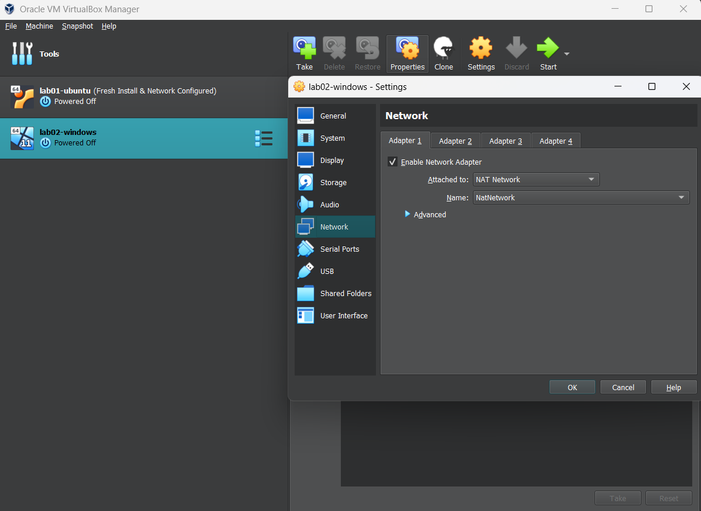

### Step 10 — Install Windows and verify its edition and address

Start `lab02-windows` and follow Windows Setup. Select the language and keyboard, install to the unallocated virtual disk, and complete the first-run setup. Select the edition provided by the Enterprise Evaluation ISO. Use a unique local lab password if the installer offers that option. After reboot, eject the ISO if prompted and confirm it is no longer mounted under **Settings → Storage**. Run `winver` to record the installed edition, then open PowerShell and run:

```powershell
ipconfig
route print -4
```

Record the actual address and gateway. The existing evidence shows Windows at `10.0.2.4` with a route through `10.0.2.1`. Capture the relevant installer or `winver` screen as `evidence/09a-windows-edition.png` so the chosen edition is clear.

**Why:** `winver` verifies which edition was installed instead of inferring it from the ISO filename. `ipconfig` and `route print` provide the address needed for repeatable connectivity checks.

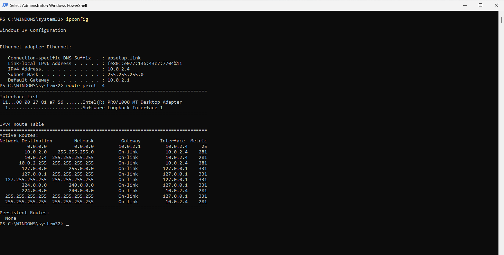

## Part 3: Network checks and recovery points

### Step 11 — Allow only the Windows ping check

In the Windows guest, open **Windows Terminal (Admin)** or **PowerShell (Admin)** and run:

```powershell
New-NetFirewallRule -DisplayName "Allow ping in (ICMPv4)" -Protocol ICMPv4 -IcmpType 8 -Direction Inbound -Action Allow
Get-NetFirewallRule -DisplayName "Allow ping in (ICMPv4)"
```

If a rule with that name already exists, inspect it rather than creating a duplicate. Keep Windows Firewall enabled.

**Why:** Windows may block inbound echo requests by default. This narrowly scoped rule permits the lab's connectivity check without turning off the firewall.

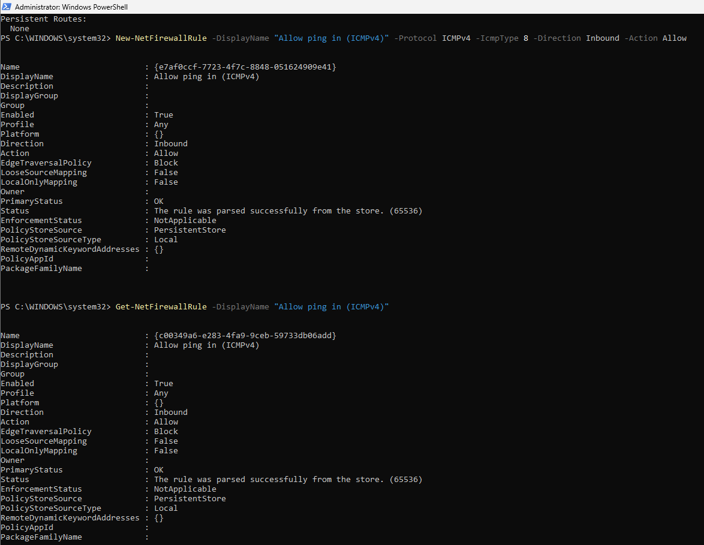

### Step 12 — Test guest-to-guest and internet connectivity

Use the actual addresses recorded in Steps 5 and 10. From Ubuntu, run:

```bash
ping -c 4 10.0.2.4
ping -c 4 ubuntu.com
```

From Windows PowerShell, run:

```powershell
ping -n 4 10.0.2.5
ping -n 4 ubuntu.com
```

Record complete command output. The evidence files show four replies in both guest-to-guest directions and successful name-based pings from both guests. A failed ping alone does not prove the internet is unavailable because some networks filter ICMP; record the actual result and use an approved HTTPS check if needed.

**Why:** The first pair checks guest-to-guest communication; the second pair checks outbound access and DNS name resolution. Keeping the outputs as text makes the result easier to inspect than a screenshot of a terminal.

- [Bidirectional guest ping output](evidence/05-ping-between-guests.txt)
- [Internet ping output from both guests](evidence/11c-ping-internet)

### Step 13 — Take and restore a clean snapshot

Shut down each guest cleanly. In VirtualBox Manager, select `lab01-ubuntu`, open **Snapshots**, choose **Take**, and name the snapshot `Fresh Install & Network Configured`. Repeat for `lab02-windows`. Verify that each VM has the named snapshot and capture both snapshot lists.

To roll a guest back, shut it down, open its **Snapshots** view, select `Fresh Install & Network Configured`, and choose **Restore**. Restoring discards changes made to that guest's disks since the snapshot; take a separate snapshot first if you need to preserve the current guest state. Confirm the restore, then start the guest and verify that it boots. A snapshot is a rollback point, not an independent backup.

**Why:** A clean snapshot makes it possible to return the test guest to its known starting state after a failed experiment. Explaining restoration and its data-loss effect makes the “without breaking anything” expectation concrete.

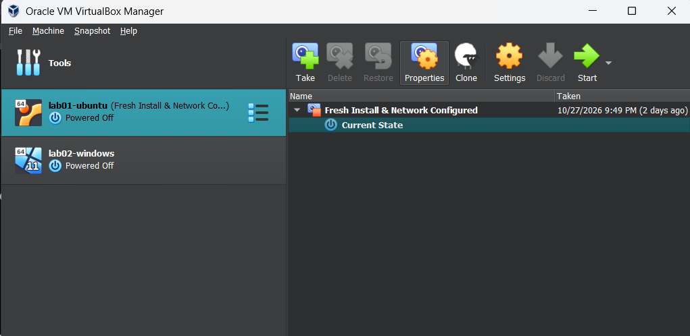

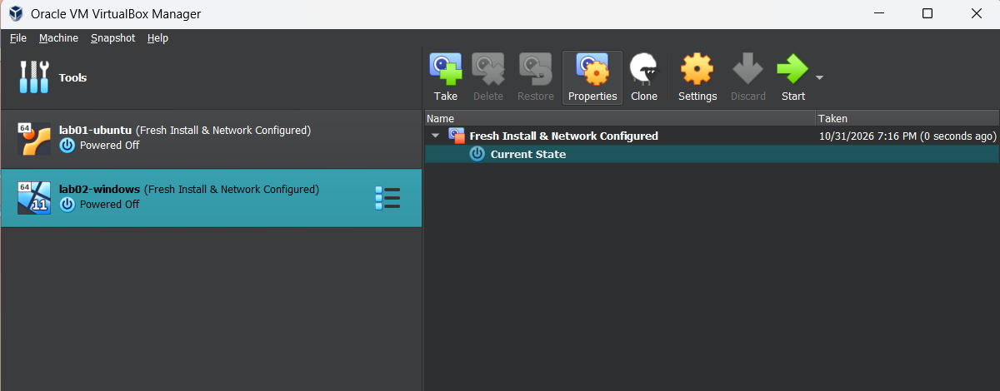
